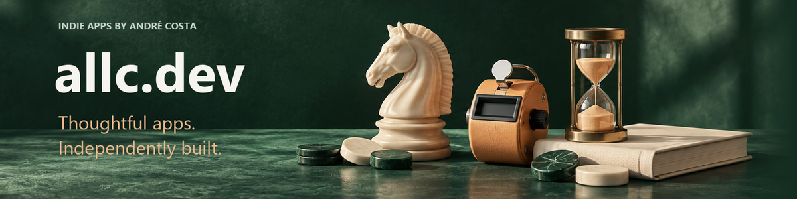

# Hi, I’m André.

I’m the solo developer behind **[allc.dev](https://allc.dev)**. I build useful apps with care, and keep improving them with your feedback.

My background is in software architecture, working with Delphi, PHP/Laravel, Vue and Flutter. Here, I share the independent products I design, build and maintain.

**[Explore the apps](https://allc.dev/#apps)** · **[Google Play](https://apps.allc.dev)** · **[YouTube demos](https://www.youtube.com/@allc-dev)** · **[Email](mailto:allc.dev@outlook.com)** · **[WhatsApp](https://wa.me/5512988543055)**

## A family of useful apps

| App | A little help with… |
| :--- | :--- |
| [ChessTime](https://allc.dev/apps/chesstime/) | A chess clock for your next game. |
| [MultiCounter](https://allc.dev/apps/multicounter/) | Stock, reps, rows. Make every count count. |
| [Focodoro](https://allc.dev/apps/focodoro/) | Make room for focused work and proper breaks. |
| [Habitus](https://allc.dev/apps/habitus/) | Build a routine, one small habit at a time. |
| [Petlog](https://allc.dev/apps/petlog/) | Keep your pet’s care and routines together. |
| [Serena](https://allc.dev/apps/serena/) | A little space to check in with yourself. |
| [ExacTime](https://allc.dev/apps/exactime/) | Turn your screen into a clock worth looking at. |
| [Quietude](https://allc.dev/apps/quietude/) | Set the mood with your own mix of ambient sounds. |
| [Nexus](https://allc.dev/apps/nexus/) | Small challenges for memory, attention and logic. |
| [Bíblia](https://allc.dev/apps/biblia/) | Read, highlight and make time for the Bible. |
| [BookQuest](https://allc.dev/apps/bookquest/) | A daily Bible quiz, with reading along the way. |

Bíblia and BookQuest are available in Portuguese. Check each Google Play listing for supported languages and availability.

## Made with care. Improved together.

Have a suggestion or found a bug? Your feedback helps me decide what to improve next. You can reach me through [the website](https://allc.dev/#contact), by [email](mailto:allc.dev@outlook.com) or [WhatsApp](https://wa.me/5512988543055).

**ALLC PRO** is the existing subscription shared across my apps. Benefits and subscription options are explained inside each app.

---

[Website](https://allc.dev) · [Google Play](https://apps.allc.dev) · [YouTube](https://www.youtube.com/@allc-dev) · [WhatsApp](https://wa.me/5512988543055)
